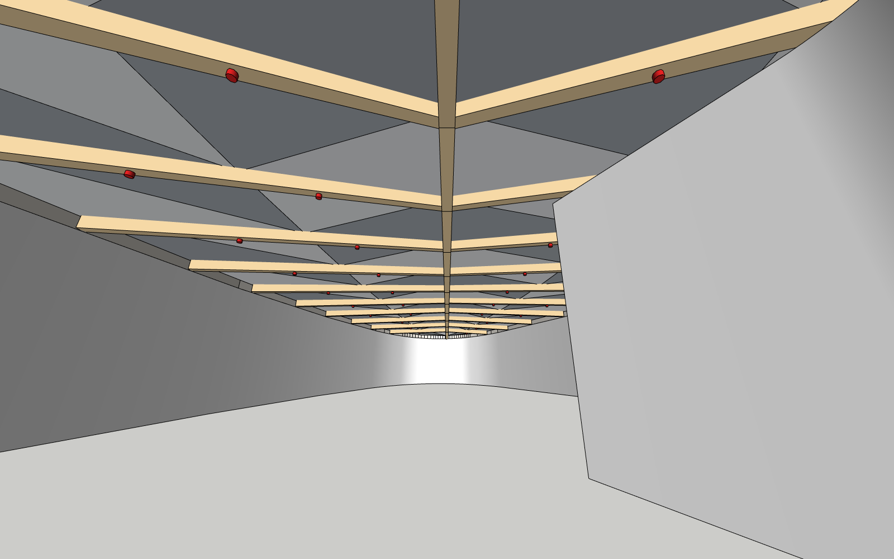
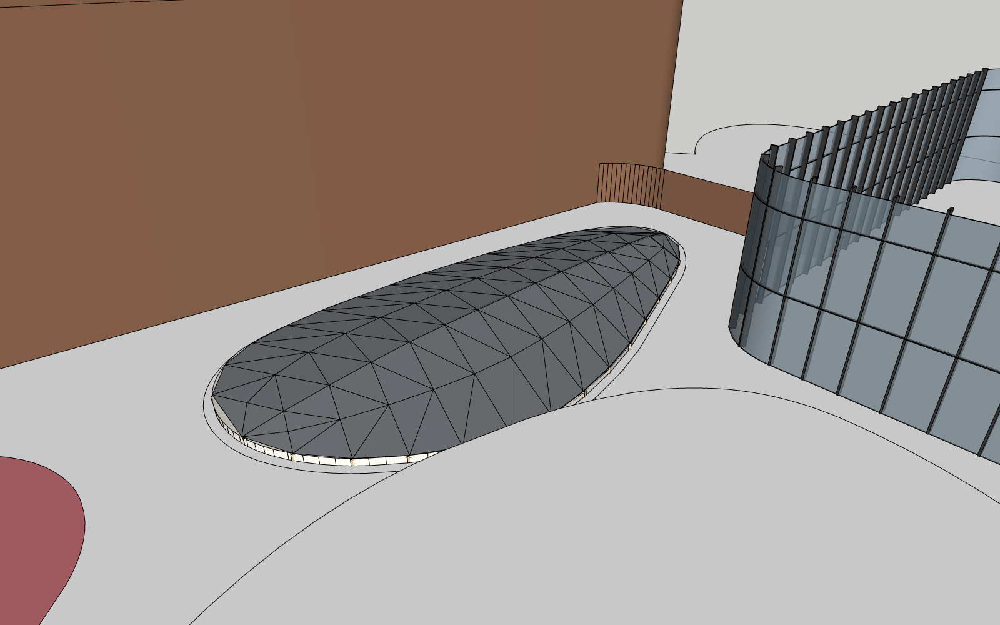

# Study: an agent builds the missing atrium roof (2026-11-08)

**Why:** before designing the bridge/edit ops (M1b/M2), a development agent (Claude Code) did the whole job once by hand: find the atrium, read the references, build the roof in SketchUp, check it. The study shows **which steps and which information the process really needs**, and which of them the plugin/protocol must provide.

**Status:** auto-run in SketchUp 24.0.553 on a copy of `samples/models/20261020_skylight_model.skp`. The result is `samples/models/20261020_skylight_model_roof_proposal_v2.skp`: the proposal is one group "MB Atrium Skylight Roof (proposal)" on tag `MB_Proposal`, and the rest of the model is unchanged. **Not reviewed by the user yet**: the target opening and all dimensions below are the agent's assumptions.

Scripts: `hosts/sketchup/dev/studies/atrium_roof/` (`openings.rb` → `build.rb` (+`params.json`) → `check.rb`), run unattended with `hosts/sketchup/dev/autorun_script.rb` (`run.ps1`).

| | |
|---|---|
|  |  |
| View from inside the opening, compare with the reference render | Aerial view (towers hidden) |

## What was built

| Layer | From | Value used |
|---|---|---|
| Outline | inner loop of face `su:1656115` (ledge ring in `Group#23 > Group#46`, the podium slab) | 90 points, 224.43 m², ledge z = 0.17 m |
| Form | render: ridge along the long axis, chevron beams, zigzag triangles | ridge along PCA axis (24.65 m, dir (0.722, −0.692)); eave level all round (curb top 0.47 m); pitch 6° along the shorter beam at each station, so ends become hips; ridge max 1.108 m |
| Beams | sketch: "existing primary structure" 100×200 RHS; red note 铝板包裹斜向次梁 (aluminium-wrapped diagonal secondary beams) | 13 stations at 1.8 m, sweep 22°; wrapped envelope 150×260 (ridge 180×300); champagne wrap colour from the render |
| Roof panel | sketch: "proposed fire rated solid roof panel" 防火板, 30 | 114 triangles, each a 30 mm solid, planar by construction (checked: 0.0 mm) |
| Ceiling | sketch: 普通铝板，尺寸同三角玻璃，两种颜色 (plain aluminium panels, same size as the triangular glass, two colours) | same triangles 90 mm below the top, two greys alternating |
| Edge | (no information) | curb 0.30 m + flat flashing pieces where straight panel edges meet the curved outline (sag ≤ 0.25 m) |
| Sprinklers | sketch: 喷淋 below the beam | 40 heads under the beams, ~2.5 m spacing (symbolic) |

Check (`check.rb`): the tower podium soffit (`组#5 > 组#85`, z 7.47) lies over the SW part of the opening, ≈ 6.4 m above the ridge, so there is no clash. Rays also report faces of `Group#368` (cooling-tower/equipment area) at z 1.37 next to the NE end. That reading is suspicious (the rays started above that height) and has **not been explained**, so the NE end needs a look by a human.

## The steps it took, and what each one needed

| # | Step | Information needed | Where it came from this time | What the product should provide |
|---|---|---|---|---|
| 1 | **Which opening is "the atrium"?** | The target element | Not given (no export from the user yet). Search: all inner loops of horizontal faces → 11 candidates; 4 glazed (`Glass_Skylight`), 1 unglazed and open to the sky → chosen. Takes 3 SketchUp runs and judgement | The user's **outline/pin on the rim** (M1a+ already exports the face ref and path). Add: for a picked face, its **loops** (outer and holes) in world meters, so the boundary comes with the pick |
| 2 | Exact boundary | Polygon, level, which loop (slab hole 245.75 m² vs ledge ring 224.43 m² vs soffit hole 170.08 m²) | Walked the model, matched `persistent_id` | Op `get_geometry(ref, path)` → loops, plane, area. Decide in the packet which loop the outline snapped to |
| 3 | Context around it | Levels (ledge 0.17, slab −2.83..0.17), what is above (tower soffit 7.47), neighbours (curtain wall, equipment) | Raytests and bounding-box queries | Ops `find_entities(within_bbox)` and `raycast(origin, dir)` → hit point and path; the packet could carry "above/below" hits for each pin |
| 4 | Design intent | Pattern, layers, materials | Render (pattern, colours) + sketch (build-up, notes in Chinese). Read visually | Works already: references + notes in the brief. A registered reference (M3) would also give sizes |
| 5 | **Numbers the references don't give** | Pitch/rise, beam spacing, chevron angle, beam sizes, curb height, ceiling gap, sprinkler spacing, eave level | **Assumed** (see table above) | The proposal must surface these as **named parameters with defaults** that the user can change, i.e. a parametric op instead of a one-shot mesh |
| 6 | Existing vs. new | The sketch labels the beams "existing" structure (a fire upgrade of a glass skylight?), but the model has no structure here | Unresolved, so the beams were modelled as new | An explicit question in the restated task: "existing skylight to retrofit, or new roof?" |
| 7 | Build | Create groups/tags/materials, faces, solids, one undo step | `run_host_script` style: 400 lines of Ruby | Ops: `open_proposal` (own tag + one operation), `add_mesh(triangles, material)`, `extrude_faces(thickness)`, `sweep_box(segments, w, d)`, `apply_material`; plus `save_copy` |
| 8 | Look at it | Renders from chosen cameras; hide occluders (towers); camera must not sit inside a solid | `write_image` with computed cameras; the first two attempts were inside walls/towers | `render_view(camera, hide_refs[], isolate_refs[])` returning the PNG; a raytest to check the camera position |
| 9 | Verify | Planarity, clashes/clearance, compare with the reference | `check.rb` + visual comparison of the view from below with the render | `check_proposal` (clearance rays, planarity, solid check); side-by-side image with the reference |
| 10 | Hand back | Where it is, what was assumed, how to remove it | This document | `close_proposal` with a summary + parameter table; accept/reject in the panel |

## Findings (to carry into M1b/M2)

1. **Identification was the most expensive step**, and the only one decided by judgement rather than data. A single outline on the rim would have removed steps 1–2 (3 of 7 SketchUp runs). This confirms that M1a+ pointing comes first.
2. **Boundary loops must travel with the pick.** An outline drawn by the user gives ~10 clicked points, but the build needs the real 90-point edge. Pick → face → loop is cheap on the host side, so export it (or serve it with `get_geometry`).
3. **References give intent, not numbers.** Everything dimensional except "30 mm" and "100×200" was assumed. The useful format for a proposal is **generator + parameters**, not baked geometry: re-running `build.rb` with a new `params.json` takes 3 s.
4. **A small set of mesh-level ops covers this whole build:** `add_mesh` (triangles + material), `extrude_faces`, `sweep_box`, `group/tag/material`, `raycast`, `render_view` with hide/isolate. Box/push-pull ops (`create_box`, `push_pull`) would not have been enough for a curved, triangulated roof. These ops should come before most of the M3 list.
5. **The escape hatch was essential.** `autorun_script.rb` (run any Ruby against a model copy, save a copy, quit) is effectively `run_host_script`. Keep it dev-only; promote patterns from it into ops.
6. **Verification needs geometry, not just pictures:** clearance rays found the tower overhead and an unexplained hit near the equipment. Planarity is guaranteed by building only triangles.
7. **Questions an operational agent must ask before modelling** (none of them answered here): Is this the right opening? Is it a retrofit of an existing skylight or a new roof? What pitch/rise? What module or beam spacing (≈ glass module)? What eave/curb detail? Which colours?

## Re-run

```powershell
# SketchUp must be closed. Works on a COPY; the original is never opened.
$s = "<repo>\hosts\sketchup\dev\studies\atrium_roof"
Copy-Item "<repo>\samples\models\20261020_skylight_model.skp" "$env:TEMP\work_copy.skp"
& "$s\run.ps1" -Script "$s\build.rb" -Out "$env:TEMP\mb_roof" -Model "$env:TEMP\work_copy.skp" -SaveAs "$env:TEMP\mb_roof\result.skp"
```

Edit `params.json` (e.g. `{"slope_deg": 8, "spacing": 1.5}`) to change any default in `build.rb`'s `P` table.
