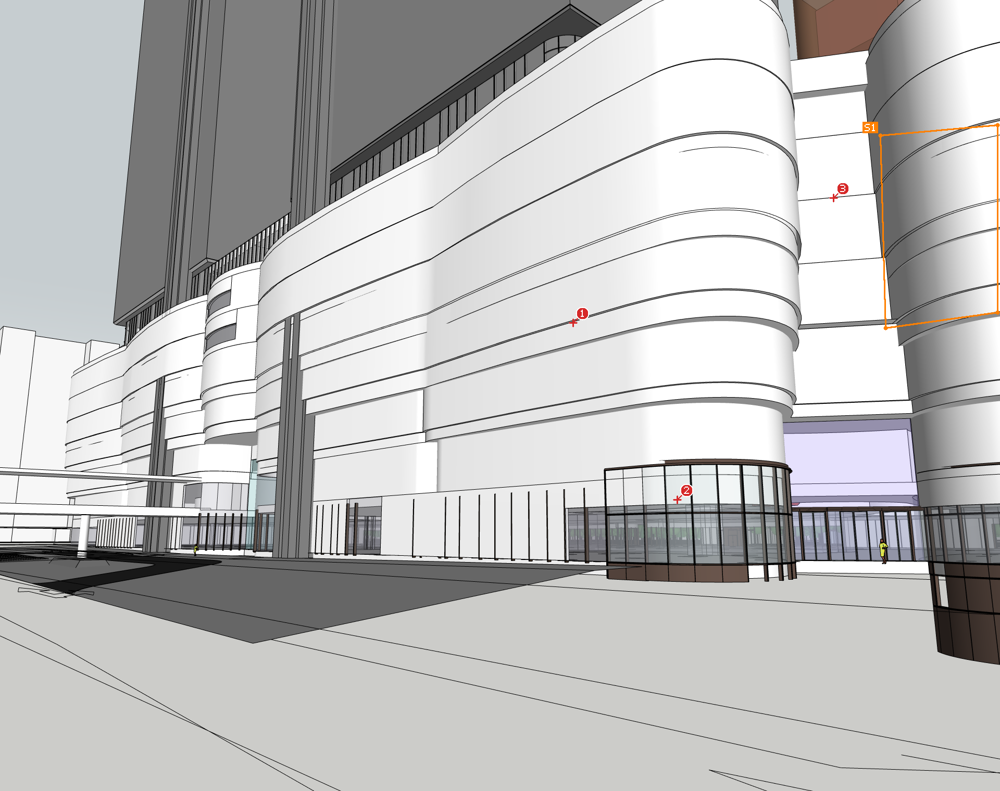
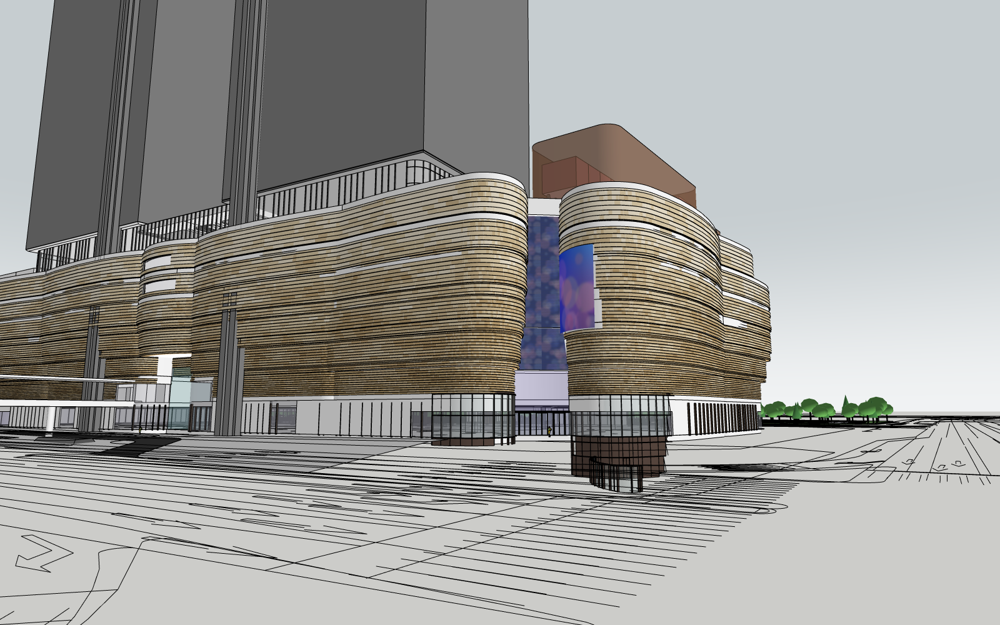

# Study: facade panels handed to a clean-context agent (2026-11-08)

Same setup as `park-handoff.md`. A designer agent framed the SE entrance at street level and marked up the task (`hosts/sketchup/dev/studies/facade_markup.rb`):
- **pin 1:** pebble panels on the curved podium volumes;
- **pin 2:** keep the storefront base;
- **pin 3:** LED media mesh in the slot;
- **outline S1:** the billboard.

References were a **cropped panel close-up marked "governs the look"** plus downscaled copies of the SE and hero renders. A fresh subagent got only the user's one-liner and the export. Base model: the park result.

**Result:** `facade_proposal.skp` (15.4 MB). It has one group on tag `MB_Facade_Proposal` with:
- **Pebble panels:** 43.8k faces in 5 tones. Strips are 0.34 m high at the bottom, growing to 0.86 m at the top; panel lengths 1–3.8 m with random stagger and 0.10–0.24 m relief.
- **LED mesh:** one textured plane in the slot.
- **Curved billboard.**

Existing geometry is untouched. It took 82 tool calls, ~248k tokens and ~27 min. The restatement before building was correct. **Not reviewed by the user yet.**

| Designer's export | Agent's result (reference-like view) |
|---|---|
|  |  |

## What worked better than the park run
- The **"governs the look"** note and the **crop** removed the "which reference wins" problem; the agent never asked about it.
- **Downscaled references** caused no image trouble.
- **Pins on the faces themselves** gave exact surfaces and groups to start from.

## Friction (agent's log + designer review)

| Problem | Fix (product) |
|---|---|
| `path_detail` = `group > group[mat White] > group`: no names or levels, so the agent had to reverse-engineer 11 band groups and the lip structure | Export a **summary of the hit group**: level/z-range, siblings, face count, tags present. Encourage naming (or auto-name by level) |
| Designer pointed at the existing facade-type tags; they only partly cover the outline and contradict the massing (lower levels tagged GLAZING where solid) | Don't hint at tags without checking them; the export could report **tag coverage** for hit groups |
| One pin for the LED slot gives a point, not the extent | A **polygon** for areas, a pin for single things. The Outline tool on faces would have defined the mesh directly |
| S1 billboard: best-fit plane of 4 points on a curved surface points into the building, and S1's position differs from the render (designer's own error) | Per-point normals in the packet (have them in capture, not exported for strokes); export-time check: "outline on a curved surface" |
| "Up to the terrace edges" is undefined in the model; the 2 m setback rule was a guess | The designer should outline the scope, or select the groups (selection is exported already) |
| Feature cut-out windows in the reference had no location, so they were not modelled | The designer should pin wanted features or say "not needed" |
| Errors abort the save silently (a non-planar quad); every run reopens a 10 MB model (10–50 s); no interactive geometry queries, so the agent exported JSON and analysed it in Python | M1b bridge: live session, `get_geometry`, ops that fail with readable errors |
| Edge style decides the look (the first build read as dark brick until the agent softened edges) | Style is part of `render_view` / designer preference |

## Takeaways
1. Two handoffs, two correct restatements: **the export carries intent well**.
2. What costs tokens is **discovery of the model's structure**, and it was mostly the same kind both times: unnamed groups, frames, tags. A project notes file (`project.md`) and a hit-group summary in the export attack exactly that.
3. Designer markup quality matters as much as the plugin. Both runs had a designer error (DWG "registered"; billboard outline vs. render). The plugin can catch some of these with export-time checks.
