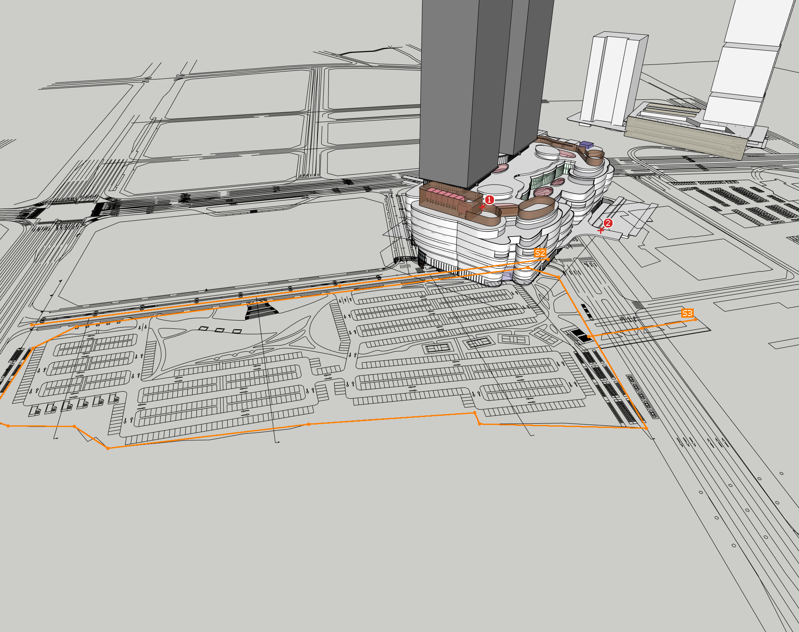
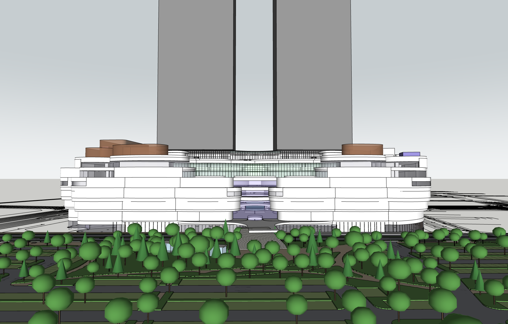

# Study: a designer hands off the north park to a clean-context agent (2026-11-08)

**Setup:** one agent (Claude Code) played the **designer**: it read the files, looked at the model, marked up the task with the plugin's own stores (`hosts/sketchup/dev/studies/park_markup.rb`) and exported it. A **subagent with a clean context** played the operational agent. It received only the user's one-line request, the export (`latest.json` → brief), `docs/agent-guide.md`, and a way to run Ruby in SketchUp (`autorun_script.rb` via `run.ps1`). Inputs: `samples/models/20260330_Massing.skp`, `Site Plan.dwg`, `siteplan_cad.jpg`, `aerial.jpg`, two renders.

**Result:** the agent built the park and car park at massing level: 178 ground regions coloured per the CAD legend, the road, the west bridge with stairs and escalator, the amphitheatre, pavilions and 408 trees. Everything is in one group on its own tags; the mall is untouched and the original model was not overwritten. It took 79 tool calls and ~21 min. The hero and aerial views read like the references. **Not reviewed by the user yet.**

| Designer's export (annotated) | Agent's result, hero view |
|---|---|
|  |  |

## The most important finding: the designer's mistake

The designer imported the DWG with its original coordinates kept, saw it land next to the mall, and wrote "already imported **and registered**" in the task. **That was wrong.** The mall model is rotated about 44° relative to the CAD, and the marked road S2 actually ran through the mall podium.

The agent noticed this before building. It fitted the mall's ground-floor outline to the empty CAD block south of the road: the facade runs parallel to the kerb, the entrance notch lines up with the amphitheatre, and the mall's existing +6 m bridge lands on the CAD bridge landing. It then moved the park (and the DWG) into the mall's frame. That transform is **unconfirmed** (≈1–2 m, 0.5°).

So the clean-context agent was more careful than the designer, but it also had to make a big unilateral decision: move the DWG to the mall rather than the mall to the DWG. Lesson: **the export must state facts the plugin can check, not the designer's belief.**

## Friction (designer side + agent's log)

| Problem | Fix (product) |
|---|---|
| "Registered" was a claim, not a check; nothing recorded the DWG's transform | Plugin: an explicit **registration** for imported CAD (transform + 2 control points, or a fit check against the model) stored in the packet; warn if the markup and the model are in different frames |
| Outlines in the DWG frame, pins on the mall: S2 crossed the podium, and nothing warned | Same check: flag outlines that cut through existing solids |
| Outline tool could not snap to DWG lines (edges, no faces) | **Fixed** in `outline_tool.rb` (snaps to bare linework); needs a mouse test |
| The DWG cannot be attached as a reference, only named in the task text | Reference kind `cad_in_model` → the component ref + its layer list |
| Layer names given without meaning (`REV_*`, `P34_*`, `REV_DRONE_PAD`) | Designer step: say which layers are current/what they mean; or a per-layer note |
| The CAD jpg (most useful reference) had no placement; the agent registered it by edge matching | Reference registration (M3), or at least 2 corner points |
| References disagree (render: glass domes, little parking; CAD and photo: square pavilions, lots of parking) and nothing says which wins | A priority field per reference (e.g. "CAD governs layout, render governs look") |
| 5000 px / 27 MB reference images copied at full size | Export downscaled previews next to the originals |
| Annotated image draws outlines over everything; S1 partly off screen (`in_frame: false`); the first designer camera was hidden by a tower | Occlusion-aware or dimmed drawing; warn on export when a mark is out of frame |
| Pins on unnamed groups (`group > group > face`): "the mall" had to be inferred | Name groups, or let the designer name a pin's target |
| DWG is linework only (8,078 segments → only 274 faces found by SketchUp); the agent rebuilt regions in Python (shapely) | An op `regions_from_linework(layers, legend_image?)`, or ask for a hatched/closed-polyline export |
| No live view: every check is a full SketchUp start (10–30 s); `DisplayShadows` option raised; grazing light made ground dark; PIL not found under `python -I` | M1b bridge (live session), `render_view` presets |

## Does the workflow hold?

Yes. Designer prep → markup → export → clean-context agent built the right thing, and its restatement (written before building) was accurate. The handoff carried enough for intent. **Geometry facts** (frames, registration, which reference governs) are where it broke, and those are things the plugin can verify or ask for at export time. Next: registration of imported CAD/references, an export-time sanity check, and downscaled reference previews, before the M1b bridge.

Result model (not in the repo): `%TEMP%\claude\...\scratchpad\mall\agent_out\park_proposal.skp`, see the chat.
